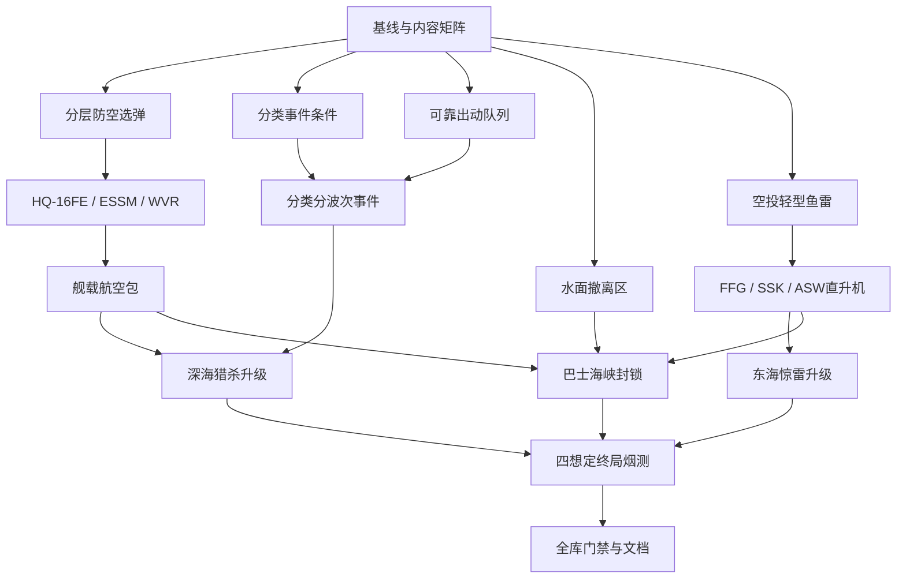

# AEGIS-CMO 内容扩充实施与平衡计划

> 对应矩阵：[`CONTENT_EXPANSION_MATRIX.md`](CONTENT_EXPANSION_MATRIX.md)
> 基线门禁：133 unit/integration tests、13 E2E、95.10% engine line coverage、Catalog 23/16/15/9、3 想定。
> 目标：先补机制门槛，再按可运行纵向切片扩充 Catalog 和想定。

## 1. 不可变契约

1. 固定 `0.25s` 世界步进；所有随机裁决使用世界 PRNG。
2. Recording v2 继续校验 ruleset、Catalog、Scenario Schema；规则/目录/Schema 分别递增。
3. 自动决策、事件目标选择、威胁估算只读取本方 `TacticalContact`；物理 seeker/碰撞阶段才允许读取目标真值。
4. 影响战局的玩家动作进入 `COMMAND_ACTIONS`；显示态不进入 canonical state。
5. 新装备先通过 Catalog/Schema 编译，再进入 Runtime；不保留 runtime 双格式。
6. 每个新增条目必须被内置想定、机库或事件实际消费并有测试。

## 2. 依赖图



## 3. 阶段 1：机制门槛

### 3.1 分层防空选弹

当前风险：自动拦截只取首个 SAM 挂架，新增中近程弹不会自然形成分层。

实现规则：

1. 对每枚已观测来袭武器，枚举全部 `canInterceptMissile` 且有库存/冷却完成的挂架；
2. 对每个挂架调用统一 `evaluateFireControl(..., 'defense')`；
3. 丢弃 blocked/risky 解，遵守最小射程和最大射程；
4. 计算 `rangeMarginKm = maxRangeKm - observedDistanceKm`；
5. 优先选择满足条件且 `rangeMarginKm` 最小的武器，避免近距目标浪费远程弹；
6. 同优先级按剩余库存比例、武器 ID 稳定排序；
7. 计算所有己方在途拦截弹数量，只补足 doctrine 所需拦截量；
8. 保留 40% 防空弹用于防御的旧规则仅适用于进攻机会射击，不阻断自卫拦截；
9. 不读取来袭武器隐藏目标 ID 进行威胁排序，只依据己方观测位置、航向和闭合几何。

验收：远/中/近三种武器顺序打乱后仍选择同一最合适解；首挂架不可执行时能回退；已有两枚在途时不追加；库存耗尽后切换层级。

### 3.2 Contact 分类事件

Schema：`UNIT_DETECTED.minimumClassification?: 'unknown' | 'classified' | 'identified'`，默认保持现有最宽松语义。

等级顺序：`unknown < classified < identified`。比较只使用 Contact 的 `classification` 和 `identifiedCategory`，不得查询 `units[actualUnitId].category`。

验收：同一 Contact 在 classified 时只触发 classified 事件，升级 identified 后触发 identified 事件；重复/失联重入遵循现有事件 re-arm 规则。

### 3.3 可靠机库出动队列

新增版本化运行态：

```ts
interface PendingSortieOrder {
  orderId: string;
  eventId: string;
  carrierUnitId: string;
  hangarSlotId: string;
  loadoutId?: string;
  assignedMissionId?: string;
  earliestLaunchTime: number;
  attempts: number;
  status: 'pending' | 'failed';
  failureReason?: string;
}
```

规则：

- `LAUNCH_SORTIE` 遇到甲板冷却、ready 暂时为零但存在 reserve/turnaround 时排队；
- 母舰失能、槽位消失、挂载不兼容、库存永久耗尽时明确失败并记录日志；
- 队列每 Tick 按 `earliestLaunchTime/orderId` 稳定处理；
- 成功必须调用同一个 `launchCarrierSortie`，真实消耗 ready 库存；
- 非重复事件在订单创建后视为动作已接收，不因暂时不可执行而丢失；
- 重放必须得到相同订单 ID、尝试次数、起飞 Tick 和 sortie ID。

### 3.4 水面/水下撤离区

扩展 `ScenarioObjective`：

```ts
withdrawAreaPolygon?: [number, number][];
withdrawUnitDomains?: Domain[];
```

规则：

- 仅 `withdraw` 可设置撤离区；
- 目标单位进入区域后标记 `status='recovered'` 并停止运动/传感/交战，但不计损失；
- 空中单位仍可使用现有回收逻辑；水面/水下必须进入区域；
- 只处理 objective 明确列出的单位，不能由敌方命令越权撤出；
- 多单位 withdraw 必须全部完成才达成；
- 关键 preserve 失败仍可提前终局，不能因一艘护卫舰提前撤离误结束。

### 3.5 空投轻型鱼雷

不复用重型潜射鱼雷路径。WeaponSpec 增加可选投放配置：

```ts
launchMedium?: 'direct' | 'air_drop';
waterEntrySpeedKts?: number;
waterEntryAltitudeM?: number;
```

规则：

1. 航空平台向已观测 subsurface Contact 发射；
2. 武器先以空投段飞向估计点；
3. 到达入水点后高度切到水下、速度切到水中速度并进入 acoustic seeker 搜索；
4. 目标域只允许 subsurface（必要时允许极低速 surface）；
5. 搜索只使用 seeker 物理观察，不追踪隐藏目标运动；
6. 失联可在搜索窗口内再捕获；
7. 重型 `yu6_torpedo`/`mk48_adcap` 继续限制于舰艇/潜艇发射平台。

## 4. 阶段 2–3：Catalog 纵向切片

### 4.1 参数区间（游戏抽象）

| 数据 | 建议区间 | 校验重点 |
|---|---:|---|
| 舰载战斗机 max speed | 900–1300 kt | cruise < max；重挂载降速 40–120 kt |
| 轰炸机 max/cruise | 650–900 / 430–600 kt | 大载荷航程与加油依赖 |
| 直升机 max/cruise | 130–180 / 100–145 kt | 低高度、短航程、轻型鱼雷 |
| ISR/EW 大型机 | 300–520 kt | 长续航、无/少武器、低自卫能力 |
| FFG speed | 26–31 kt | HP/CIWS 低于 DDG，传感器与防空适中 |
| LHD/LHA speed | 20–25 kt | 高 HP、低机动、有限点防空和机库 |
| AIP SSK speed | 16–22 kt | 低速噪声小，高速噪声显著，浅海优势 |
| 远程 AAM | 300–450 km | 库存 2–4，min range 20–35 km，WRA 高威胁 |
| 中程 SAM | 45–100 km | 库存 16–48，min range 2–6 km |
| 近程 AAM | 20–40 km | 库存 2–4，优先近距目标 |
| 轻型鱼雷 | 10–25 km 水中航程 | 空投段与水中段分离，伤害低于重型鱼雷 |
| 护卫舰反舰弹 | 150–250 km | 库存 4–8，低于 DDG 饱和能力 |
| 舰载雷达 | 180–320 km | 不超过主力 DDG 顶级雷达 |
| 吊放声呐 | 25–55 km | 受浅/深海因子与温跃层影响 |
| AIP 被动阵 | 55–100 km | 低速目标、浅海杂波折减 |

### 4.2 切片 A：舰载航空

依次交付：

1. J-15T + 3 Loadout；接入福建舰槽位；
2. F/A-18E/F + AIM-174B + 3 Loadout；接入 CVN 槽位；
3. F-35B + 2 Loadout；仅兼容 America LHA；
4. 运-9G + 专用 ESM/OECM；
5. B-1B + 2 远程反舰 Loadout；
6. J-10C + 2 岸基 Loadout；
7. MQ-4C + ISR Loadout。

每个平台完成：Catalog → factory 实例化 → loadout 修正 → 发射/检测测试 → 机库/事件/想定消费。

### 4.3 切片 B：浅海反潜/护卫舰

1. 054B + Type 382B + HQ-16FE + YJ-83 + 拖曳阵；
2. Constellation + SPY-6(V)3 + ESSM Blk2 + NSM + 拖曳阵；
3. 039C + 红方 AIP 侧舷阵；
4. Taigei + 蓝方 AIP 侧舷阵；
5. 直-20F + 吊放声呐 + Yu-11；
6. MH-60R + AQS-22 + Mk54；
7. P-8A 从 Mk48 修正到 Mk54 合法空投挂载。

### 4.4 切片 C：两栖高价值核心

1. 075：有限 HQ-16/近防抽象、直-20F 机库、低速高 HP；
2. America：ESSM/近防抽象、F-35B/MH-60R 机库；
3. 两舰均配置有限 Turnaround supply、真实 ready/reserve 数量；
4. preserve/withdraw 目标与撤离区测试。

## 5. 阶段 4：现有想定接入

### 5.1 东海惊雷

- 红方：039C 浅海伏击区、054B ASW 外屏、运-9G 岸基电子支援、J-10C/J-15T 增援；
- 蓝方：Constellation、Taigei、KC-135、B-1B、MQ-4C；
- 链条：MQ-4C/运-9G 侦察 → MALD 消耗 → SEAD → B-1B/H-6/J-15T 饱和攻击；
- 反潜：P-8A/MH-60R/Mk54 对 039C，直-20F/Yu-11 对 Taigei/Virginia；
- 防空：HHQ-9B/SM-6 远层，HQ-16FE/ESSM 中层，WVR/CIWS 近层。

### 5.2 深海猎杀

- 福建舰：J-35 隐身制空 + J-15T 重锤 + J-16D 电子伴随；
- 美航母：F-35C 隐身制空 + F/A-18E/F 重锤 + EA-18G 电子伴随；
- 未确认航母：仅 ISR/CAP；
- classified HVA：加油机前出、电子支援改派；
- identified carrier：可靠队列创建满挂载波次并设置协同释放；
- 首轮后由 Turnaround 和补给决定第二轮能力。

## 6. 阶段 5：巴士海峡封锁

### 6.1 结构

- 时长：初始 2700 秒（45 分钟），平衡后可扩至 3600 秒；
- 蓝方核心：America LHA，目标 preserve + 进入东侧撤离区 withdraw；
- 红方核心：075/岸导/039C 或阻断部队，目标阻止撤离并保全关键岸导；
- 环境：西侧浅海声学区、东侧深水区、岛链陆地禁区、单一明确撤离走廊；
- 航空：F-35B/MH-60R 与 J-15T/直-20F 轮换；
- 水下：039C/Taigei/Virginia 的浅深海交界伏击；
- 水面：054B/Constellation 反潜外屏；
- 事件：岸导开机、SEAD、分类确认、可靠机库波次、护航 Turnaround。

### 6.2 胜利路径

蓝方路径：ISR 确认 → MH-60R 清理近区 → F-35B/FFG 压制岸导 → LHA 进入撤离区。
红方路径：AIP 隐蔽伏击 → 诱饵消耗 ESSM → 岸导/舰载机协同攻击 → 使 LHA 失能或阻止超时撤离。

必须提供自动化关键路径夹具，不要求 AI 自主完成全部玩家操作，但命令必须合法并可重放。

## 7. 固定种子烟测

统一种子：

- 基线无命令：`4242`
- 分波次/机库压力：`5150`
- 反潜/环境：`8080`
- 玩家关键路径重放：`202612`

每个想定记录：

```text
scenarioId, seed, endedTick, reason, outcomes,
red/blue losses, red/blue missiles fired, interceptions,
sorties launched, fired events, AAR events, track samples,
remaining hangar inventory, pending sortie orders
```

失败条件：未在 `durationSec`/关键终局停止、存在 NaN/Infinity、目标一直 pending、非重复事件重复计分、队列永久 pending 且没有明确失败原因、Catalog/Scenario 引用悬空。

## 8. 阶段门禁

每个纵向切片：

```bash
bun test <相关测试>
bun run validate:db
bun run build
git diff --check
```

每个 Phase：

```bash
bun test
bun run validate:db
bun run build
bun run test:e2e        # UI/地图变化
bun run test:coverage   # 引擎高风险变化
```

最终：

```bash
bun test
bun run validate:db
bun run build
bun run test:e2e
bun run test:coverage
bun run docs:api
git diff --check
```

## 9. 版本策略

- Catalog 数据/挂载/平台变化：`MASTER_EQUIPMENT_CATALOG.version` → `2026.12-CONTENT-EXPANSION-1`；
- 选弹、出动队列、撤离、鱼雷物理规则变化：提升 `RULESET_VERSION`；
- Event/Objectives/Weapon/Platform 可序列化字段变化：提升 `SCENARIO_SCHEMA_VERSION`；
- Recording 仍为 v2；旧 ruleset/catalog/schema 录像明确拒绝，不做静默迁移。

## 10. 回滚方式

1. 机制与内容分批：先合入 Schema/读兼容，再写新数据；
2. 每个新增平台按独立 Catalog 对象和 Loadout 组提交，可单独撤回；
3. 想定升级保留原始目标 ID，新增单位/事件可逐组移除；
4. 新想定作为独立常量加入 `BUILTIN_SCENARIOS`，不改旧想定 ID；
5. 可靠出动队列无订单时保持旧行为；撤离区未配置时保持现有航空回收语义；
6. 轻型鱼雷新字段缺省为 `direct`，旧重型鱼雷行为不变；
7. 平衡失败优先回滚数据参数，不撤销已验证的通用机制。

## 11. 完成定义

只有在数量下限满足、所有新增条目有真实消费、两大想定升级、第四想定双方路径与终局通过、版本递增、全门禁零失败、README/GAMEPLAY/矩阵/最终报告数量一致后，目标才可声明完成。
