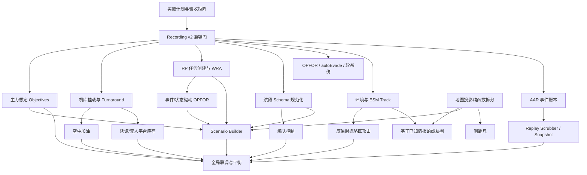

# AEGIS-CMO 产品化实施计划

> 基线：`83c4f1e`（2026-10-31）
> 依据：当前源码、`GAMEPLAY.md`、装备/想定 Schema、现有测试与生产构建。
> 原则：先保护确定性与有限信息契约，再扩展仿真规则；每个阶段均保持可运行、可回放、可回滚。
> **执行状态：已完成。** 最终逐项证据与门禁结果见 [`FINAL_VERIFICATION.md`](FINAL_VERIFICATION.md)。

## 1. 目标与边界

本计划把当前确定性技术底座升级为具备以下闭环的单机 Web 兵棋产品：

1. 有明确任务目标和战后结算的主力想定；
2. 舰载机“选择挂载—出动—回收—整备—再次出动”的有限库存循环；
3. 玩家可创建任务、配置基础 WRA、规划分段航路并控制编队；
4. OPFOR 可依据事件与已观测状态进行确定性反应；
5. 规避、软杀伤、简化环境、ESM 融合和反辐射概略区攻击遵守有限信息边界；
6. 可按 Tick 回放、复盘统计、测距并显示基于已知情报的威胁圈；
7. 沙盒可编辑并导出可重新导入的完整想定；
8. 空中加油、诱饵和无人平台具备简化但闭环的资源玩法；
9. 新增仿真状态和命令可确定性记录、重放和校验。

不建设全球 GIS/DEM/水深数据库、完整导弹能量学、通用自主智能体、多人服务端权威或专业 GIS 编辑器。装备参数始终是游戏抽象，不作真实性认证。

## 2. 当前源码基线

### 2.1 已确认能力

| 能力 | 源码证据 | 当前契约 |
|---|---|---|
| 固定步进与 PRNG | `src/engine/determinism.ts` | 固定 `0.25s`，PRNG 状态进入世界状态 |
| 模块化世界步进 | `src/engine/simulation/worldStepper.ts` | 运动→感知→自动交战→武器→事件/目标 |
| 有限信息火控 | `src/engine/fireControl.ts`, `src/engine/guidance.ts` | 授权使用 Contact 估计点；制导更新受观测/数据链约束 |
| 任务最小状态机 | `src/engine/operations.ts` | 5 秒决策、区域追击、返航与任务区恢复 |
| 机库有限首次出动 | `src/engine/simulation/unitPhysics.ts`, `src/store/useWargameStore.ts` | ready/reserve 守恒，但回收不回库 |
| 想定事件 | `src/engine/scenarioEvents.ts`, `src/engine/simulation/eventResolver.ts` | 时间、摧毁、发现、区域进入触发动作 |
| 目标结算 | `src/engine/objectives.ts` | destroy/disable/preserve/observe/withdraw |
| 指令录像 | `src/store/battleRecording.ts` | v1 记录 seed/scenario/commands，但无规则与 Catalog 版本校验 |
| 想定编译边界 | `src/scenarios/compileScenario.ts` | 导入前校验和 Legacy mission assignment 规范化 |
| 地图性能边界 | `src/map/TacticalMapCanvas.tsx` | Zustand 瞬态订阅直推 GeoJSON；当前 867 行 |

### 2.2 已确认缺口

| 缺口 | 证据/影响 |
|---|---|
| Recording v1 可静默漂移 | 录像头不含 ruleset/catalog/schema 版本，规则或主 Catalog 变化后仍可能被接受 |
| 两大主力想定无 objectives | `builtinScenarios.ts` 只有 `victoryConditions`，无法按主要目标结算 |
| 回收不进入整备队列 | `operations.ts` 将飞机设为 `recovered`；没有一次性回库标记、队列或重新补给 |
| 机库没有起飞前挂载选择 UI | Store 已校验 `customLoadoutId`，UI 仍传 `slot.selectedLoadoutId` |
| Reference Point 不可绑定任务 | 可创建/删除 RP，但 Store 没有创建/编辑 Mission 的命令 |
| WRA 仅有基础约束 | 有统一火控、齐射和拦截弹保留规则，缺少玩家可配置射程比例/库存保留 |
| `autoEvade` 未进入仿真 | 字段与 `evading` 状态已定义但无行为 |
| ESM 仍是圆形 AOU | 多源只将误差乘 `0.45`，没有方位走廊和几何融合 |
| 环境不参与裁决 | 在线/离线底图仅渲染；固定温跃层适用于所有海域 |
| 无可恢复时间轴与完整 AAR | 只能从开局重放到末尾；UI 日志仅保留 250 条 |
| 重复 Store 无消费者 | `scenarioStore.ts`、`simulationStore.ts`、`uiStore.ts` 无导入者，权威状态仍是 `useWargameStore.ts` |

### 2.3 验证基线

计划制定时的基线为：

- `bun test`：97 pass / 0 fail；
- `bun run test:e2e`：3 pass / 0 fail；
- `bun run validate:db`：通过；
- `bun run build`：通过。

所有阶段必须至少保持这一基线，不允许以“后续统一修复”为由提交不可构建中间态。

## 3. 不可破坏的设计契约

1. **确定性**：只允许固定步进和序列化 PRNG；仿真代码禁止 `Math.random`、当前时间和帧率依赖。
2. **命令记录**：任何改变 canonicalBattleState 的玩家动作必须加入 `COMMAND_ACTIONS`，记录 Tick、sequence 和完整参数。
3. **有限信息**：AI、规避、威胁圈和制导不得使用未观测位置、隐藏平台 ID/配置、隐藏导引头状态或真实 HP 做决策。
4. **权限**：`playerSide` 决定指挥权；`activePerspective` 只决定观察；GOD 视角不自动授予命令权。
5. **编译边界**：旧想定、旧坐标航点等 Legacy 输入只在 `compileScenario` 规范化，运行时只保留一种格式。
6. **录像兼容性**：旧 v1 允许明确拒绝；不允许在新规则下静默生成不同结果。
7. **地图数据边界**：在线底图永不作为仿真输入；所有碰撞/环境数据随想定或本地版本化数据分发。
8. **最小完整实现**：先做可解释的游戏机制，不用未建模的“NEZ”“真实能量学”等术语掩盖简化规则。

## 4. 依赖图与执行顺序



### 推荐交付序列

1. Phase 0：计划与 Recording v2；
2. 快速安全切片：Objectives、机库挂载 UI、删除无引用 Store；
3. 核心闭环：Turnaround；
4. 指挥玩法：RP Mission、WRA、航段与编队；
5. 战术反应：OPFOR、autoEvade、软杀伤；
6. 环境/ESM/ARM；
7. AAR/回放/态势工具；
8. Scenario Builder、空中加油、诱饵/无人平台；
9. 地图维护性收尾、平衡与全局验收。

地图投影拆分是地图重功能的前置切片，可以在 Phase 4/5 之前提前完成，不必等待其他 Phase 全部结束。

## 5. Schema 与数据迁移方案

### 5.1 Recording v2

拟增加：

```ts
interface BattleRecordingV2 {
  version: 2;
  rulesetVersion: string;
  catalogVersion: string;
  scenarioSchemaVersion: number;
  scenario: ScenarioDefinition;
  seed: number;
  untilTick: number;
  commands: RecordedCommand[];
}
```

规则：

- v1 输入报出明确的“不支持旧录像”错误；
- ruleset/catalog/schema 任一不匹配即在改变当前 Store 前拒绝；
- 自定义 Catalog Overlay 仍通过 scenario 编译校验；基础 Catalog 版本必须匹配；
- 可选记录最终 canonical digest，用于诊断而非替代版本校验；
- Replay 失败继续保持现有原子回滚。

### 5.2 机库与 Turnaround

`RuntimeHangarSlot` 增加单调 sortie 序列和整备队列；不再通过 ready/reserve 反推 sortie ID：

```ts
interface TurnaroundEntry {
  sortieId: string;
  platformId: string;
  previousLoadoutId?: string;
  readyAtSimTime: number;
  state: 'recovering' | 'refueling' | 'rearming';
}

interface RuntimeHangarSlot {
  // existing fields
  nextSortieNumber: number;
  turnaroundQueue: TurnaroundEntry[];
}
```

迁移：运行时由 `unitFactory` 为旧 Platform Hangar 配置初始化 `nextSortieNumber=1` 和空队列；静态 Catalog 暂不保存动态队列。回收飞机保留为 AAR 记录，但通过显式 `recoveryProcessed`/队列关联保证只入队一次。

第一版补给模型采用“有限机体 + 时间约束 + 明确的舰载航空弹药库存”。如为控制范围先采用抽象弹药点，也必须计入母舰状态并守恒，不能在每次创建 RuntimeUnit 时无条件生成弹药。

### 5.3 航段格式

静态 Scenario 输入允许 Legacy 坐标数组，编译后统一为：

```ts
interface RouteLeg {
  position: [number, number];
  speedKts?: number;
  altitudeM?: number;
}
```

- `InitialUnitPlacement.waypoints` 可在输入边界兼容旧数组；
- `RuntimeUnit.waypoints` 只保存 `RouteLeg[]`；
- 地图、导出、命令参数和引擎只读新格式；
- 导出始终输出当前 schema 版本。

### 5.4 Mission 与 WRA

Mission 扩展为可选路线/角色配置；Doctrine 增加简单可解释规则：

```ts
interface WeaponReleaseRules {
  automaticRangeFraction: number; // 0..1
  reserveRounds: number;
  allowedTargetDomains?: Domain[];
}
```

后续可按 weapon/category 覆盖，但第一版避免建立复杂规则 DSL。Escort/SEAD/AEW/Tanker 使用判别配置和明确状态，不用散落布尔字段。

### 5.5 autoEvade 与软杀伤

RuntimeUnit 增加版本化、可序列化的规避状态，例如触发时间、到期时间、原航路快照/恢复标记和诱饵库存。触发输入必须是本方 `observeMissile` 结果或明确的被动告警模型，不得直接使用隐藏目标 ID 判断“这枚弹是否打我”。软杀伤随机裁决使用世界 PRNG。

### 5.6 环境

Scenario 增加可选本地环境层：

```ts
interface ScenarioEnvironment {
  landExclusionPolygons?: Polygon[];
  terrainMaskZones?: TerrainZone[];
  acousticZones?: AcousticZone[];
}
```

第一版是想定级简化区，不导入在线瓦片。移动使用 swept segment/边界判定；传感器只查询版本化环境层。

### 5.7 Bearing-only Track 与 ARM

Contact/AOU 增加 uncertainty kind 与观测线证据：圆形、方位走廊、融合椭圆。玩家态势继续使用估计几何；隐藏 `actualUnitId` 仅允许内部 track association/最终物理命中，不作为玩家或 AI 授权输入。

Weapon target 增加显式 `area`/`bearing` 类型，概略区攻击携带记录时刻的估计几何和辐射信息，不要求未发现 RuntimeUnit ID。

### 5.8 AAR 与 Snapshot

新增不受 UI 250 条日志上限影响的紧凑 `BattleEventLedger`。只记录复盘所需事件和采样航迹，不复制每 Tick 全状态。Replay snapshot 为版本化缓存，不是新的权威存档；任一 snapshot 恢复结果必须等于从开局重放到同 Tick 的 canonical 状态。

### 5.9 加油、诱饵与无人平台

- 加油：机载可转移燃油、兼容关系、会合条件、队列和中断状态均进入 canonical state；
- 诱饵：作为可观测 RuntimeUnit/Deployable，而不是 UI 特效；
- seeker 欺骗：只能依据导引头当前可观测候选和序列化 PRNG；
- 无人平台沿用单位、任务、燃油和传感器体系，不新增第二套仿真框架。

## 6. 分阶段实施与验收

## Phase 0：计划与兼容性护栏

### 0.1 详细实施计划

交付本文档。验收：包含源码证据、依赖图、Schema 迁移、阶段、风险、回滚、测试和逐项矩阵；后续架构取舍变化必须同步更新。

### 0.2 Recording v2

交付：版本常量、v2 类型、捕获/加载校验、明确错误、回滚测试和跨批次一致性测试。

验收：

- v1、规则不匹配、Catalog 不匹配、Schema 不匹配均在 Store 变更前拒绝；
- 合法 v2 在 1/5/15/60 Tick 批次得到相同 canonical state；
- 非法 action/sequence/tick 仍拒绝并原子回滚；
- JSON UI 明确显示兼容要求。

## Phase 1：目标与舰载机闭环

### 1.1 主力想定 Objectives

- 每方至少一个 required 主目标；
- 可选目标体现侦察、保全和撤出；
- 关键目标仅在明确标记时提前终局；
- 编译器拒绝悬空 unit ID；
- 两大想定的超时、关键失败、代价胜利均有测试。

### 1.2 机库挂载选择

- UI 只列出 slot.availableLoadoutIds；
- 选择是 UI 准备态，最终 `launchCarrierAircraft` 命令记录 loadout ID；
- Store 继续校验挂载存在、兼容、可用、权限、库存和冷却；
- E2E 覆盖选择不同挂载后 mounts 正确。

### 1.3 Turnaround

- 回收只处理一次，回收单位不计损失；
- 队列按 simTime 推进，顺序稳定；
- 机体、燃油和弹药资源守恒；
- 母舰被毁/失能后禁止回收或明确转场；
- sortie 编号单调、重放无 ID 碰撞；
- 同命令不同批次结果完全相同。

## Phase 2：任务规划与指挥控制

### 2.1 RP 创建/编辑 Mission

- 至少三个同阵营合法 RP 创建多边形；
- 拒绝跨阵营、重复点、自交/退化多边形和越权操作；
- 创建、编辑、启停、删除、分配均是记录命令；
- Mission 保存坐标快照，后续删除 RP 不破坏既有任务。

### 2.2 Mission 行为扩展

- Escort：维持相对保护范围，受威胁时交战，脱离后归位；
- SEAD：只攻击已观测辐射目标/概略区；静默后按规则搜索或脱离；
- AEW：按路线循环，不在无航点时随机画圈；
- Tanker：进入加油等待区，满足条件后服务，威胁下中断；
- 每类任务均有进入、执行、脱离、恢复状态测试。

### 2.3 基础 WRA

- 自动开火最大射程比例和最低库存可由 unit/mission doctrine 控制；
- 自动行为仍只接受 executable fire-control solution；
- 手动风险授权不绕过硬约束；
- 保留现有拦截弹最低库存规则或以明确迁移替代。

### 2.4 航段与编队

- Legacy 航点规范化测试；
- 到达航段时应用该段速度/高度/潜深；
- 编队使用领队和可序列化偏移，支持同步速度/跟进；
- 返航、规避和任务临时接管后能恢复编队/航线；
- 所有编辑动作可重放。

## Phase 3：战术反应与环境

### 3.1 OPFOR 反应

优先扩展现有事件/状态系统，而不是建立黑箱 Planner：

- 从真实机库资源发起波次；
- 定时/接触触发 Blink EMCON；
- 关键目标被发现或受损后改派任务；
- 协同攻击使用明确的 launch window/hold-until 状态；
- 决策只读该阵营 Contacts 和公开自身状态。

### 3.2 autoEvade 与软杀伤

- 只响应已观测来袭武器或明确 RWR 告警；
- 采用可解释 Beam/转向规则；
- 规避到期或威胁消失后恢复原计划；
- 诱饵有库存、冷却和适用导引类型；
- 多次步进不重复消费同一次投放；
- 随机结果可重放。

### 3.3 海陆与声学环境

- 舰艇/潜艇不能穿越版本化陆地区；陆地单位不能进入海区；
- 非法航段在命令边界拒绝，移动中的边界接触有确定处理；
- 浅海/深海区改变温跃层和杂波简化系数；
- 在线底图断网不改变任何仿真结果。

### 3.4 ESM 与 ARM

- 单站 ESM 输出方位走廊；
- 多个独立平台的方位线几何融合为更小 AOU；
- 同一平台多个传感器不伪装成多站融合；
- ARM 可向合法概略区/方位解发射；
- 目标静默、重新辐射和搜索超时均有确定行为。

## Phase 4：复盘与态势工具

### 4.1 Replay Scrubber

- 可加载 v2 录像并跳转到任意合法 Tick；
- 拖动预览不追加 commandHistory；
- snapshot 命中与从头重放 canonical 等价；
- 跳过终局、非法 Tick、损坏快照均明确拒绝。

### 4.2 AAR

- 统计分武器发射、命中、拦截、损失、出动、回收、补给；
- 航迹按固定采样规则保存；
- 战斗中只展示己方合法信息，战后才可揭示完整真值；
- 统计不依赖被截断的 UI 日志。

### 4.3 测距与威胁圈

- 测距尺给出大圆距离和真方位；
- 威胁圈只依据 Contact 已知分类/识别结果和公开推定模型；
- 未识别目标不得通过 `actualUnitId` 查询真实 Catalog 配置；
- 工具状态属于显示态，不进入 canonical state，除非用户保存为命令对象。

## Phase 5：Scenario Builder 与新玩法

### 5.1 可视化编辑器

- 沙盒拖动/创建/删除单位；
- 编辑编组、任务、目标和基础事件；
- 绘制任务区/触发区；
- 导出通过 `compileScenario`，重新导入后结构等价；
- 不导出运行时损伤、已触发事件等非开局数据。

### 5.2 空中加油

- 加油机可转移燃油有限；
- 兼容、距离、速度/高度和状态条件明确；
- 多机请求有稳定队列；
- 中断、威胁、返航和加油机耗尽有测试；
- 总燃油守恒且重放确定。

### 5.3 诱饵与无人平台

- 诱饵/无人机作为正常可观测实体；
- 可执行简化侦察/诱骗任务；
- 防空目标选择只读己方观测；
- 欺骗成功不等于获得隐藏真实单位信息；
- 库存、续航、损失和 AAR 均闭环。

## Phase 6：架构与全局验收

### 6.1 删除重复 Store

确认无引用后删除 `scenarioStore.ts`、`simulationStore.ts`、`uiStore.ts`。不迁移到多 Store：单一权威 Store 更符合原子命令记录和 canonical state 契约。同步清理过时文档中“待集成 Store”描述。

### 6.2 地图投影拆分

将 `syncStoreToLayers` 内的 Mission、Envelope、AOU、Waypoint、Missile、Unit/Contact、RP、Explosion 投影提取为可测试纯函数。MapLibre 生命周期、source 更新与交互仍留在 Canvas 组件。

### 6.3 联调、平衡和文档

- 更新 `GAMEPLAY.md`、README 与 Schema/录像版本说明；
- 两大想定从双方分别完成无命令基线和关键玩家流程；
- 检查目标时限、库存、出动节奏、AI 反应没有立即死局；
- 最终逐项核对本计划验收矩阵。

## 7. 命令与 canonical state 审计

每次新增动作前回答：

1. 是否改变 units/missions/events/referencePoints/objectives/environment/resource/ledger？
2. 若改变，是否加入 `COMMAND_ACTIONS`？
3. 参数是否完全 JSON 可序列化且无需读取 UI 隐状态？
4. 权限是否在 Store/命令边界校验，而不只禁用按钮？
5. Replay 时同一命令失败是否能通过 commandSequence 检测并回滚？
6. 新增 runtime 字段是否已包含在 deep clone、canonical state 和 snapshot？

显示态（面板开关、光标、录像预览 Tick、Ruler 临时端点）默认不进入 canonical state。会改变战局的 Mission 编辑、航段、编队、WRA、机库操作、Builder 实体编辑必须记录。

## 8. 测试与阶段门禁

### 8.1 测试层级

| 层级 | 必测内容 |
|---|---|
| Unit | 几何、队列、状态机、融合、资源守恒、Schema 规范化 |
| Integration | Store 权限、命令记录、世界步进、事件/目标、Replay canonical 等价 |
| E2E | 挂载出动、RP 建任务、航线编辑、回放、Builder 导入导出、Ruler |
| Catalog validation | 新平台、挂载、库存、兼容、环境/想定引用 |
| Build | TypeScript、Vite、无未处理 Schema 联合类型 |

### 8.2 阶段门禁

每个叶子任务至少运行受影响测试；每个 Phase 结束运行：

```bash
bun test
bun run validate:db
bun run build
```

涉及 UI/地图/完整流程时额外运行：

```bash
bun run test:e2e
```

高风险引擎变更额外运行：

```bash
bun run test:coverage
```

### 8.3 负面检查

最终必须确认：

- 仿真目录没有 `Math.random`；
- 未使用 `Date.now`/`crypto` 生成仿真实体 ID；
- 所有 canonical 玩家动作都在 `COMMAND_ACTIONS`；
- AI/威胁圈/规避没有使用隐藏 `actualUnitId` 或真实 Platform 配置；
- 没有重复权威 Store；
- v1/不匹配录像明确拒绝；
- 新旧想定 JSON 均在编译边界得到单一 runtime 格式。

## 9. 风险、缓解与回滚

| 风险 | 后果 | 缓解 | 回滚方式 |
|---|---|---|---|
| 录像规则漂移 | 旧录像静默产生不同战果 | 先交付 Recording v2；版本不匹配拒绝 | 保留 v2 类型和拒绝路径，回退具体新规则 |
| Turnaround 重复入库/ID 冲突 | 无限机体或覆盖实体 | 显式处理标记、队列、单调序列、守恒测试 | Feature flag/Scenario 未配置时保持旧单次出动 |
| AI 读取世界真值 | 破坏有限信息玩法 | 决策 API 只接收 Contacts/Observation | 回退新增 AI action，不回退观测边界测试 |
| 航点双格式扩散 | 每个模块都分支处理 | 只在 compileScenario 兼容旧格式 | 保留输入迁移，回退新 UI/行为 |
| 在线地图参与裁决 | 离线不一致、不可重放 | 环境数据随想定版本化 | 未配置环境时使用明确的 open-water 默认 |
| AAR 状态膨胀 | 内存/录像体积过大 | 固定采样、紧凑事件、上限和估算测试 | 降低采样频率，不删除事件契约 |
| Scenario Builder 产生非法 JSON | 无法重新载入 | 所有导出立即走 compileScenario | 保留文本 JSON 编辑作为逃生路径 |
| 软杀伤数值失衡 | 导弹完全无效或无意义 | 独立于真实参数，以回归场景校准 | 数据参数回滚，无需回滚 Schema |
| 大范围并行重构 | 中间版本不可用 | 纵向切片，小步提交，Phase 门禁 | 每个切片独立可撤回 |

## 10. 回滚原则

1. Schema 采用可选字段和编译默认值，先支持读、再开始写；
2. 规则变更与内容变更分开，方便单独回退平衡参数；
3. 每个 Phase 合并前保持上一版本想定仍可加载；
4. Recording v2 一旦发布不降回 v1；可以提升 rulesetVersion 并拒绝旧规则；
5. 不通过保留重复 Store、双航点格式或双 AI 路径来“兼容”失败实现；回滚应删除新路径而非长期维护两套权威状态。

## 11. 逐项验收矩阵

| 目标任务 | 可观察结果 | 主要自动化证据 |
|---|---|---|
| 0-1 计划 | 本文档完整且与源码一致 | 人工复核路径、依赖、Schema、风险、门禁 |
| 0-2 Recording v2 | 不兼容明确拒绝，合法录像跨批次一致 | recording/replay integration tests |
| 1-1 Objectives | 两大想定均可按 required 目标结算 | scenario/objective tests |
| 1-2 机库挂载 | 起飞前可选合法挂载，最终 mounts 正确 | Store integration + E2E |
| 1-3 Turnaround | 回收后按时再次出动且库存守恒 | queue/resource/replay tests |
| 2-1 RP Mission | 地图 RP 创建、编辑、分配任务 | command/replay + E2E |
| 2-2 Mission 行为 | Escort/SEAD/AEW/Tanker 状态完整 | state-machine tests |
| 2-3 WRA | 射程比例/库存保留影响自动火力 | auto-defense tests |
| 2-4 航段/编队 | 分段速度高度和编队跟进可执行 | migration/physics/replay + E2E |
| 3-1 OPFOR | 事件/状态触发出动、EMCON、协同 | deterministic scenario tests |
| 3-2 Evade/软杀伤 | 已观测威胁触发且库存/随机可重放 | observation/PRNG tests |
| 3-3 环境 | 海陆/声学区改变合法移动和探测 | environment/physics tests |
| 3-4 ESM/ARM | 走廊→融合 AOU→概略区攻击 | geometry/guidance tests |
| 4-1 Scrubber | 任意 Tick 状态等于从头重放 | snapshot canonical tests + E2E |
| 4-2 AAR | 航迹和武器/损失统计完整 | ledger aggregation tests |
| 4-3 Ruler/威胁圈 | 测距正确且不泄露隐藏平台 | map projection + information-boundary tests |
| 5-1 Builder | 可视化编辑后导出/重导入等价 | schema round-trip + E2E |
| 5-2 加油 | 有限燃油转移和队列闭环 | conservation/state tests |
| 5-3 诱饵/无人 | 可被探测、诱骗、损失和统计 | sensor/targeting/resource tests |
| 6-1 Store 清理 | 只有一个权威 Store，无旧导入 | grep + build + full tests |
| 6-2 地图拆分 | Canvas 变薄，投影函数可单测 | map unit tests + E2E |
| 6-3 全局验收 | 全部成功标准和门禁 0 failures | final verification report |

## 12. 完成定义

只有在所有叶子任务验收通过、文档与最终实现一致、全套测试/校验/构建为 0 failures，并完成负面检查后，目标才可声明完成。功能存在但未进入命令记录、使用隐藏真值、资源不守恒、不能重新导入或没有针对性测试，均视为未完成。
